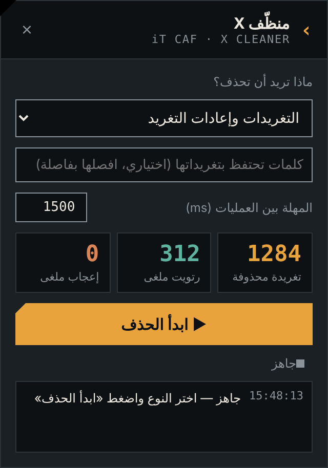
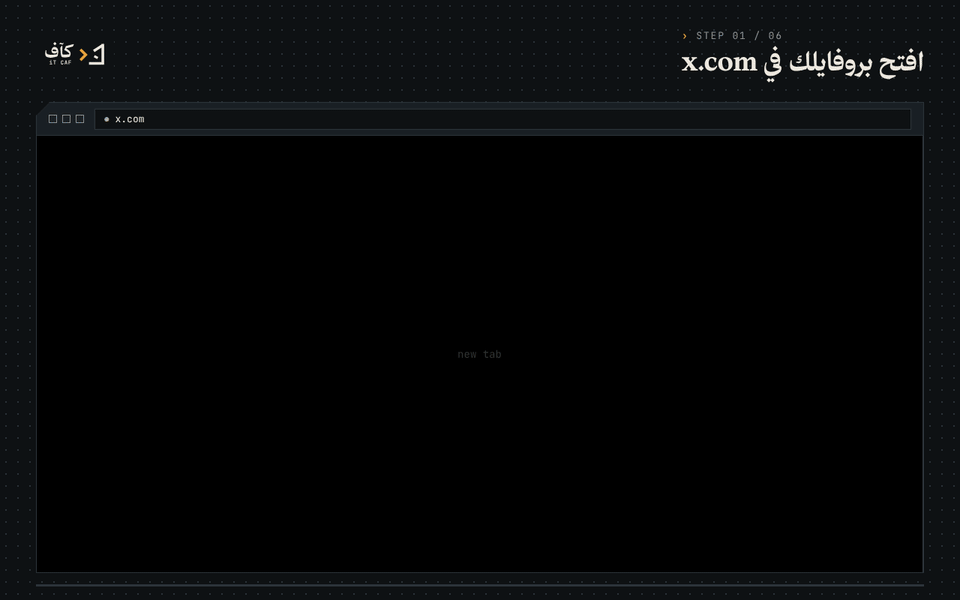
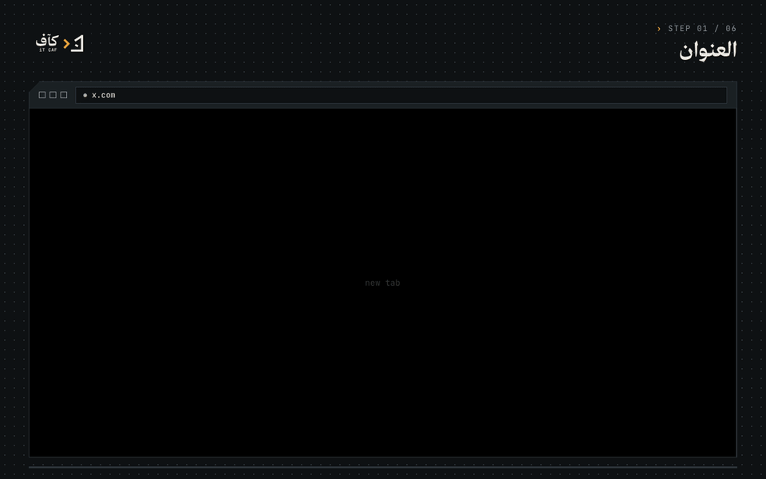
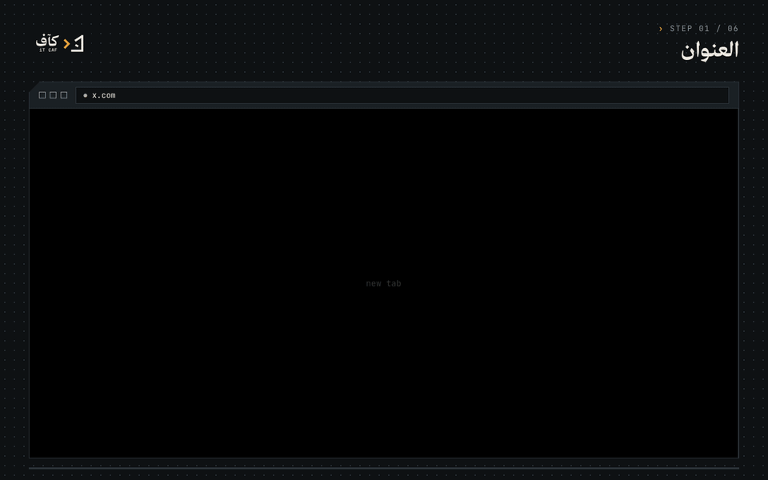
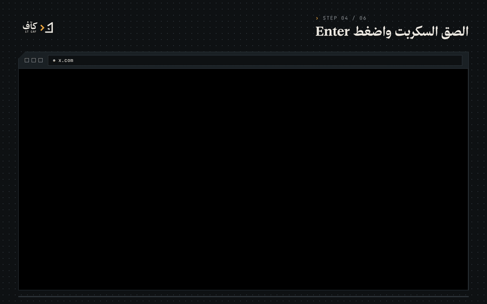
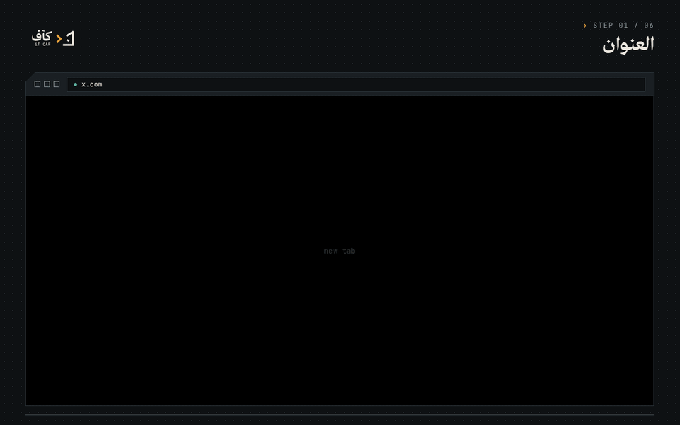
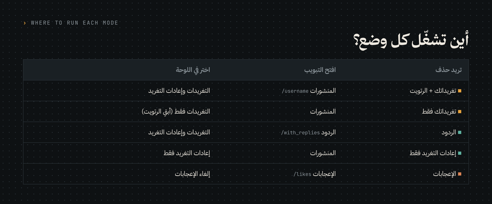

<div dir="rtl" align="right">


# منظّف X · X Cleaner

**احذف تغريداتك وردودك وإعادات التغريد والإعجابات من حسابك في X (تويتر) — من متصفح كروم مباشرة، مجانًا.**

سكربت واحد تلصقه في Console، فتظهر لك لوحة تحكم عربية تختار منها ماذا تريد أن تحذف، وتتابع العدّاد وهو يعمل.

<p align="right">


</p>

---

## المحتويات

- [ما الذي يفعله؟](#ما-الذي-يفعله)
- [قبل أن تبدأ](#قبل-أن-تبدأ)
- [الطريقة خطوة بخطوة](#الطريقة-خطوة-بخطوة)
- [أين تشغّل كل وضع؟](#أين-تشغّل-كل-وضع)
- [سكربتات مختصرة](#سكربتات-مختصرة)
- [لحذف كل شيء (أكثر من 3,200 تغريدة)](#لحذف-كل-شيء-أكثر-من-3200-تغريدة)
- [حل المشاكل](#حل-المشاكل)
- [الأمان والخصوصية](#الأمان-والخصوصية)

---

## ما الذي يفعله؟

السكربت يكرر ما كنت ستفعله بيدك، لكن آليًا: يضغط على النقاط الثلاث `···` ثم «حذف» ثم يؤكد، وينتقل للتغريدة التالية.

| | الميزة |
|---|---|
| 🗑️ | حذف تغريداتك وردودك |
| ↻ | إلغاء كل إعادات التغريد (Retweets) |
| ♡ | إلغاء كل الإعجابات |
| 🛡️ | الاحتفاظ بتغريدات تحتوي على كلمات تحددها أنت |
| ⏸️ | إيقاف وتشغيل في أي لحظة، مع عدّاد مباشر |
| ⏱️ | استراحة تلقائية كل 100 عملية لتقليل الحظر المؤقت |
| 🌐 | يعمل مع واجهة X بالعربية والإنجليزية |

<p align="center"></p>

---

## قبل أن تبدأ

> ⚠️ **الحذف نهائي ولا يمكن التراجع عنه.** إذا أردت نسخة من تغريداتك، حمّل أرشيف حسابك أولًا:
> الإعدادات والخصوصية ← حسابك ← تنزيل أرشيف بياناتك. يصلك الأرشيف خلال 24 ساعة تقريبًا.

- استخدم **كروم على الكمبيوتر** (أو Edge أو Brave). لا يعمل من تطبيق الجوال.
- كن مسجّل الدخول في حسابك على [x.com](https://x.com).
- اقرأ السكربت قبل تشغيله. لا تلصق في Console كودًا لا تفهمه، من أي مصدر كان.

---

## الطريقة خطوة بخطوة

<p align="center"></p>

### ١. افتح بروفايلك

ادخل `x.com` من كروم واضغط على **الملف الشخصي**، وتأكد أنك على تبويب **المنشورات**.



### ٢. افتح أدوات المطوّر ← Console

| النظام | الاختصار |
|---|---|
| ماك | <kbd>⌘ Cmd</kbd> + <kbd>⌥ Option</kbd> + <kbd>J</kbd> |
| ويندوز / لينكس | <kbd>Ctrl</kbd> + <kbd>Shift</kbd> + <kbd>J</kbd> أو <kbd>F12</kbd> |

بعدها اختر تبويب **Console** إن لم يكن مفتوحًا.



### ٣. اسمح باللصق

أول مرة تلصق فيها كودًا يمنعك كروم ويظهر تحذير أصفر. هذا طبيعي، فهي حماية من كروم. اكتب بيدك:

```
allow pasting
```

ثم اضغط <kbd>Enter</kbd>.



### ٤. الصق السكربت

افتح الملف [`scripts/x-cleaner.js`](scripts/x-cleaner.js)، واضغط زر **Copy raw file** أعلى الملف، ثم الصقه في Console واضغط <kbd>Enter</kbd>.



### ٥. اختر النوع واضغط «ابدأ الحذف»

تظهر لوحة **منظّف X** في زاوية الصفحة:

1. **ماذا تريد أن تحذف؟** اختر الوضع المناسب ([الجدول بالأسفل](#أين-تشغّل-كل-وضع)).
2. **كلمات تحتفظ بتغريداتها** (اختياري): مثلًا `مشروع, تخرج`، وأي تغريدة فيها هذه الكلمات لن تُحذف.
3. **المهلة بين العمليات**: 1500 ملّي ثانية مناسبة. ارفعها إذا أوقفك X.
4. اضغط **ابدأ الحذف** واترك الصفحة مفتوحة. يمكنك تصغير النافذة، لكن لا تغلق التبويب.


### ٦. الردود والإعجابات

بعد انتهاء المنشورات، افتح تبويب **الردود** وشغّل اللوحة مرة ثانية، ثم تبويب **الإعجابات** واختر «إلغاء الإعجابات».



> 💡 اللوحة تبقى في الصفحة إذا تنقلت بين التبويبات داخل X. إذا حدّثت الصفحة (Refresh)، الصق السكربت مرة أخرى.

---

## أين تشغّل كل وضع؟



| تريد حذف | افتح الرابط | اختر في اللوحة |
|---|---|---|
| تغريداتك + الرتويت | `x.com/اسمك` | التغريدات وإعادات التغريد |
| تغريداتك فقط | `x.com/اسمك` | التغريدات فقط (أبقِ الرتويت) |
| الردود | `x.com/اسمك/with_replies` | التغريدات وإعادات التغريد |
| إعادات التغريد فقط | `x.com/اسمك` | إعادات التغريد فقط |
| الإعجابات | `x.com/اسمك/likes` | إلغاء الإعجابات |

---

## سكربتات مختصرة

إذا أردت أمرًا واحدًا بدون لوحة تحكم، استخدم أحد هذه الملفات. الطريقة نفسها: الصق في Console ثم Enter.

| الملف | ماذا يفعل | أين تشغّله |
|---|---|---|
| [`delete-tweets.js`](scripts/delete-tweets.js) | يحذف التغريدات ويلغي الرتويت | المنشورات أو الردود |
| [`unretweet.js`](scripts/unretweet.js) | يلغي إعادات التغريد فقط | المنشورات |
| [`unlike.js`](scripts/unlike.js) | يلغي الإعجابات | الإعجابات |

### حذف التغريدات وإلغاء الرتويت — `delete-tweets.js`

افتح تبويب **المنشورات** (أو **الردود**) ثم الصق:

```javascript
(async () => {
  const wait = ms => new Promise(r => setTimeout(r, ms));
  let count = 0, empty = 0;
  while (empty < 6) {
    const rt = document.querySelector('[data-testid="unretweet"]');
    if (rt) {
      rt.click(); await wait(600);
      document.querySelector('[data-testid="unretweetConfirm"]')?.click();
      count++; console.log('↺ رتويت ملغى', count); await wait(1200); continue;
    }
    const art = document.querySelector('article[data-testid="tweet"]:not([data-xc])');
    if (!art) { window.scrollBy(0, 2000); await wait(2500); empty++; continue; }
    empty = 0; art.dataset.xc = 1;
    const caret = art.querySelector('[data-testid="caret"]');
    if (!caret) continue;
    caret.click(); await wait(600);
    const del = [...document.querySelectorAll('[role="menuitem"]')].find(i => /^(Delete|حذف)/.test(i.innerText.trim()));
    if (!del) { document.body.dispatchEvent(new KeyboardEvent('keydown', { key: 'Escape', bubbles: true })); continue; }
    del.click(); await wait(600);
    document.querySelector('[data-testid="confirmationSheetConfirm"]')?.click();
    count++; console.log('✕ تغريدة محذوفة', count);
    await wait(1500);
  }
  console.log('✓ انتهى. المجموع:', count);
})();
```

### إلغاء إعادات التغريد فقط — `unretweet.js`

افتح تبويب **المنشورات** ثم الصق:

```javascript
(async () => {
  const wait = ms => new Promise(r => setTimeout(r, ms));
  let count = 0, empty = 0;
  while (empty < 6) {
    const rt = document.querySelector('[data-testid="unretweet"]');
    if (!rt) { window.scrollBy(0, 2000); await wait(2500); empty++; continue; }
    empty = 0;
    rt.scrollIntoView({ block: 'center' });
    rt.click(); await wait(600);
    document.querySelector('[data-testid="unretweetConfirm"]')?.click();
    count++; console.log('↺ رتويت ملغى', count);
    await wait(1200);
  }
  console.log('✓ انتهى. المجموع:', count);
})();
```

### إلغاء كل الإعجابات — `unlike.js`

افتح تبويب **الإعجابات** `x.com/اسمك/likes` ثم الصق:

```javascript
(async () => {
  const wait = ms => new Promise(r => setTimeout(r, ms));
  let count = 0, empty = 0;
  while (empty < 6) {
    const b = document.querySelector('[data-testid="unlike"]');
    if (!b) { window.scrollBy(0, 2000); await wait(2500); empty++; continue; }
    empty = 0;
    b.scrollIntoView({ block: 'center' });
    b.click();
    count++; console.log('♡ إعجاب ملغى', count);
    await wait(1000);
  }
  console.log('✓ انتهى. المجموع:', count, '— حدّث الصفحة وأعد التشغيل إن بقي شيء');
})();
```

---

## لحذف كل شيء (أكثر من 3,200 تغريدة)

X لا يعرض في البروفايل إلا آخر 3,200 تغريدة تقريبًا، فقد يبقى العدّاد يعرض رقمًا بعد أن ينتهي السكربت. لحذف القديم:

1. حمّل **أرشيف حسابك** من الإعدادات.
2. استخدم أداة [**TweetXer**](https://github.com/lucahammer/tweetXer) المجانية مفتوحة المصدر. تقرأ ملف `tweets.js` من الأرشيف وتحذف التغريدات بالمعرّف، حتى التي لا تظهر في البروفايل.
3. ارجع لمنظّف X لتنظيف ما تبقى من الرتويت والإعجابات.

التفاصيل الكاملة في [docs/full-wipe.md](docs/full-wipe.md).

---

## حل المشاكل

| المشكلة | الحل |
|---|---|
| لا يحدث شيء بعد اللصق | تأكد أنك كتبت `allow pasting` ثم ألصقت السكربت كاملًا من أول سطر لآخره |
| توقف بعد عدد من التغريدات | X وضع حدًّا مؤقتًا. انتظر ساعة إلى ساعتين، حدّث الصفحة وشغّل من جديد |
| ظهرت رسالة «حدث خطأ ما» في X | ارفع المهلة إلى 3000 أو أكثر |
| بقيت تغريدات قديمة | استخدم طريقة الأرشيف بالأعلى |
| الإعجابات لا تنحذف كلها | بعض الإعجابات لتغريدات محذوفة لا تظهر. حدّث الصفحة وأعد التشغيل |
| أريد الإيقاف | اضغط «إيقاف» في اللوحة، أو حدّث الصفحة |

المزيد في [docs/troubleshooting.md](docs/troubleshooting.md).

---

## الأمان والخصوصية

- السكربت **لا يرسل أي بيانات** لأي جهة. لا يحتوي على `fetch` ولا أي اتصال خارجي، ويعمل فقط على الأزرار الظاهرة في صفحتك.
- **لا يطلب كلمة المرور** ولا أي رمز دخول.
- الكود مفتوح وقصير: اقرأه قبل التشغيل.
- لا تثق بأي «أداة حذف» تطلب منك كلمة مرورك أو تسجيل الدخول عبرها.

> ℹ️ هذه الأداة تحاكي ضغطاتك اليدوية على واجهة X. إذا غيّر X تصميم صفحته قد تحتاج تحديثًا. افتح [Issue](../../issues) وسنحدّثها.

---

## English

**X Cleaner** is a browser-console script that deletes your tweets and replies, undoes retweets and removes likes on X (Twitter). It needs no API, no password and no server. Open your profile on x.com, open DevTools → Console, type `allow pasting`, paste [`scripts/x-cleaner.js`](scripts/x-cleaner.js) and press Enter. A control panel appears where you pick a mode and press start. For accounts with more than about 3,200 posts, use your data archive with [TweetXer](https://github.com/lucahammer/tweetXer).

---

<p align="center">
<br>
<sub>صُنع بواسطة <b>كآف · iT CAF</b> — <a href="https://github.com/iT-CAF">github.com/iT-CAF</a> · رخصة MIT</sub>
</p>

</div>
